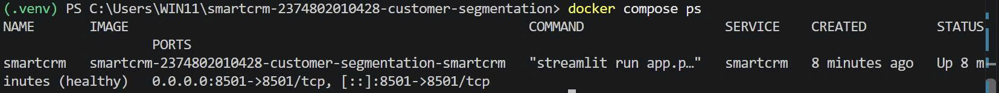
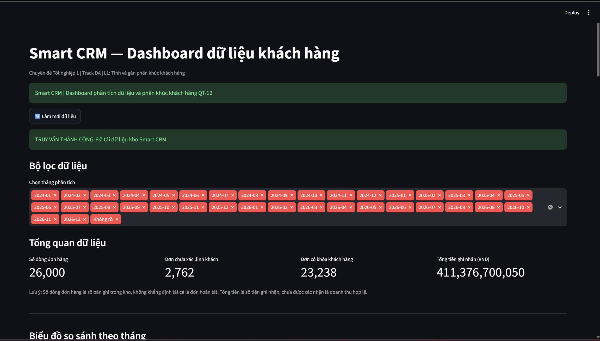
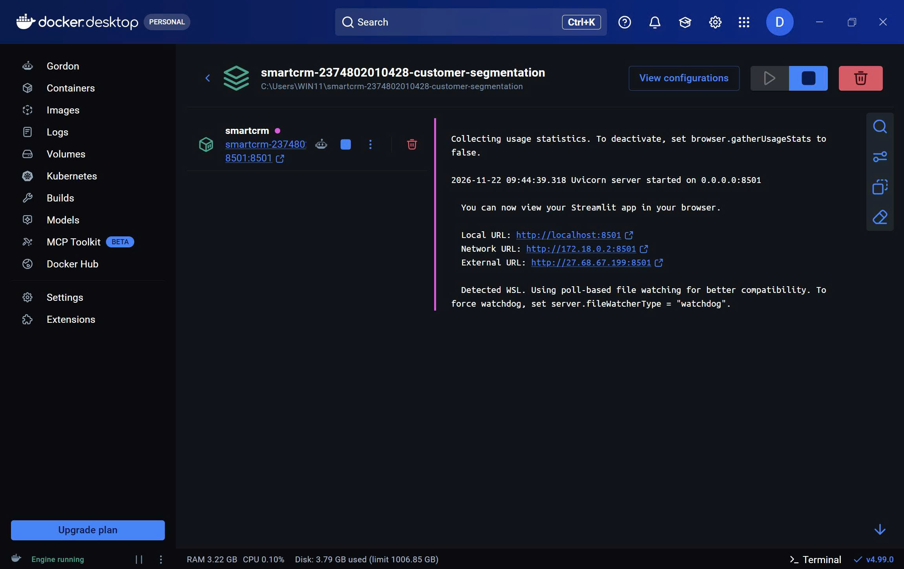

# BÁO CÁO MINH CHỨNG TRIỂN KHAI SMART CRM

**Sinh viên:** Trần Thị Như Quỳnh  
**MSSV:** 2374802010428  
**Track:** Data Analyst  
**Module:** L1 – Hồ sơ khách hàng và phân khúc

## 1. Kiểm tra Docker Container

Container Smart CRM được khởi chạy thành công bằng Docker Compose.

Trạng thái HEALTHCHECK: `healthy`.

## 2. Kiểm tra giao diện ứng dụng

Ứng dụng Smart CRM được triển khai và truy cập thông qua địa chỉ:

http://localhost:8501

## 3. Kiểm tra Docker Desktop

Container Smart CRM hiển thị trạng thái đang hoạt động trên Docker Desktop.

## 4. Kết luận

Quá trình build và khởi chạy ứng dụng Smart CRM bằng Docker Compose đã thực hiện thành công. Container hoạt động với trạng thái `healthy`, đồng thời ứng dụng có thể được truy cập thông qua cổng 8501.