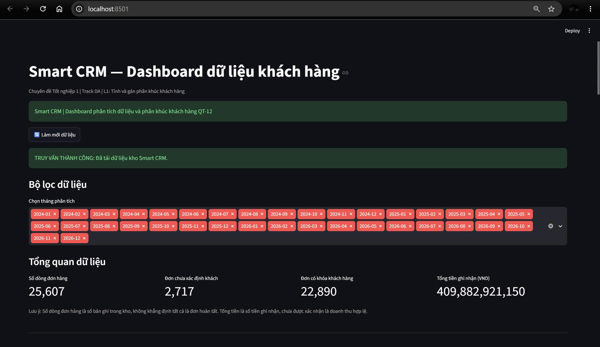
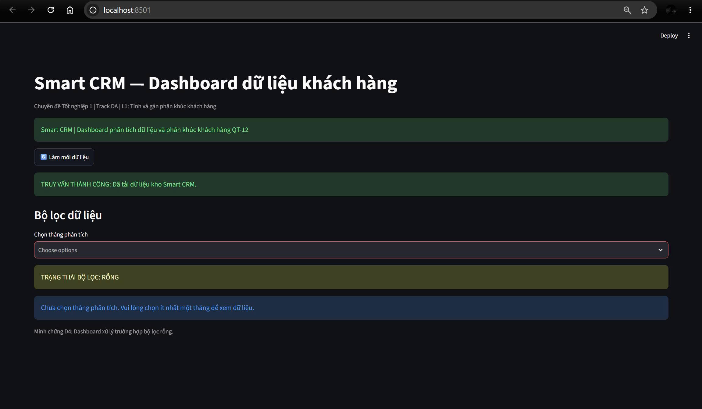
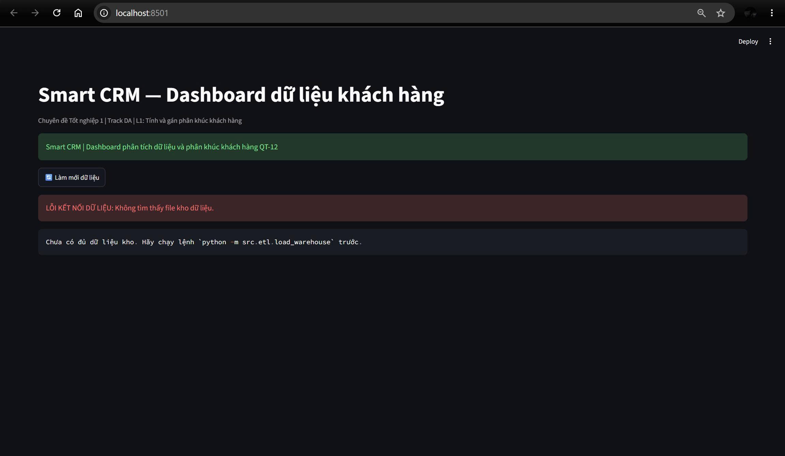
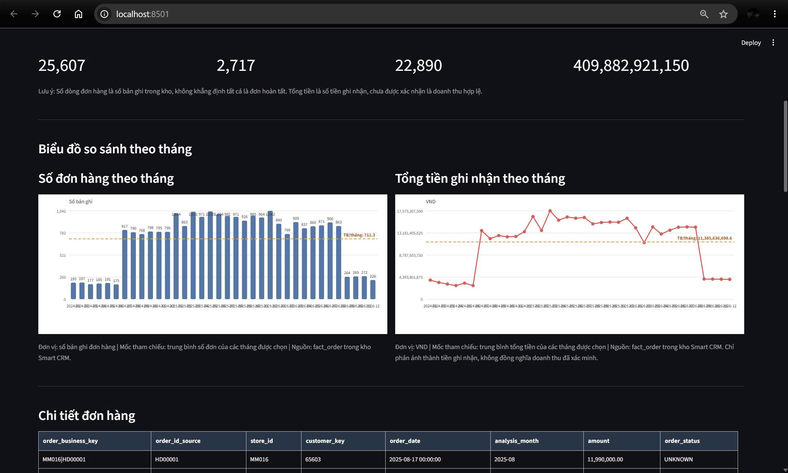
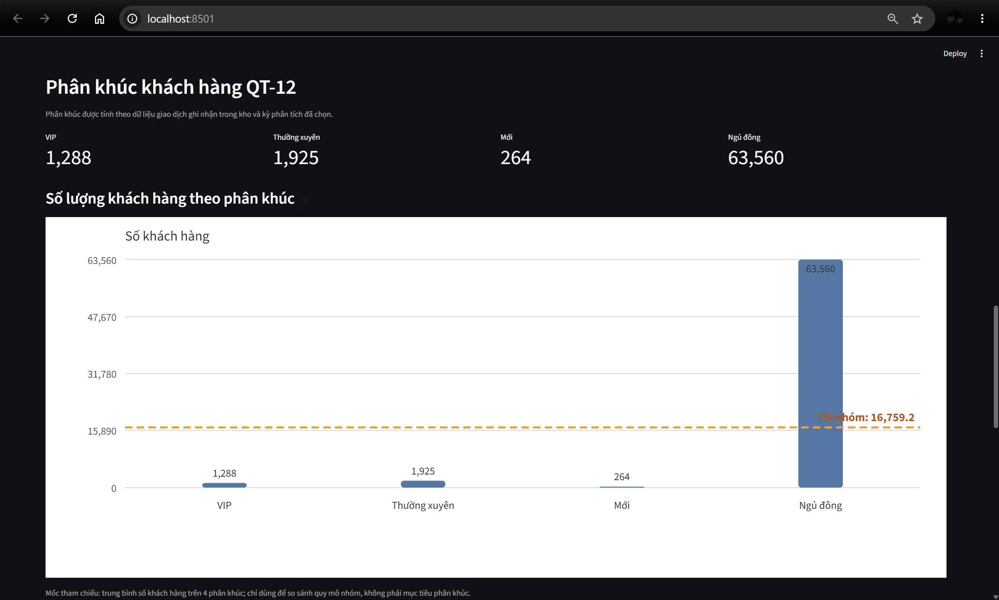

# Minh chứng BT2 – Dashboard Smart CRM

Các ảnh dưới đây ghi nhận kết quả điều chỉnh Dashboard theo phản hồi của giảng viên, tiêu chí D4.

## D4-01 – Truy vấn thành công

## D4-02 – Bộ lọc rỗng

## D4-03 – Lỗi kết nối dữ liệu

## D4-04 và D4-05 – Biểu đồ theo tháng

## D4-06 – Biểu đồ phân khúc khách hàng

